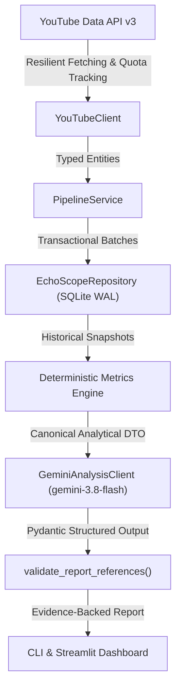

# 🏛️ Architectural Overview — EchoScope AI

## 1. System Design & Core Philosophy

EchoScope AI is architected around a strict decoupled design: **"Python calculates; Gemini interprets"**. 
All metrics and aggregations are deterministically derived by Python analytical engines before reaching the AI or presentation layer. The Large Language Model (LLM) is constrained by schema validation to act strictly as a qualitative strategic synthesizer, never calculating or hallucinating numbers.

---

## 2. Layered Responsibilities

| Layer | Module | Responsibility | Boundaries & Invariants |
| :--- | :--- | :--- | :--- |
| **API Client** | `echoscope.api.youtube_client` | Communicates with Google YouTube Data API v3. Handles typed HTTP errors (`QuotaExceededError`, `ChannelNotFoundError`), quota estimation, and publication date extraction. | No direct database persistence. Returns typed dataclasses (`ResolvedChannel`, `Video`, `VideoSnapshot`). |
| **Database** | `echoscope.database` | SQLite relational storage in WAL mode. Parameterized SQL queries, schema initialization, snapshot isolation, and retention policies. | Foreign keys enforced (`PRAGMA foreign_keys = ON;`). Zero UI logic. |
| **Analytics** | `echoscope.analytics` | Statistical calculations: median, percentiles, VSR, weighted likes-to-views ratio, views per day, inter-snapshot velocity $R$, and format classification. | 100% deterministic, offline, zero network dependencies. Honors `NULL` and `Unknown`. |
| **Artificial Intelligence** | `echoscope.ai` | Schema definitions (`EchoScopeReport`), prompt sanitization against injection, structured generation with `google-genai`, and deterministic fallback. | The model is forbidden from inventing metrics. All referenced `metric_id` entries are checked against computed catalogs. |
| **Application Service** | `echoscope.services.pipeline_service` | Central orchestrator for collection, snapshot comparison, metric computation, and AI generation. Reconciles interrupted executions. | Headless execution. Zero Streamlit or frontend dependencies. |
| **Presentation (UI)** | `ui/` & `echoscope.cli` | Headless CLI (`argparse`) and web interface (`streamlit`). | UI only imports `PipelineService` and dataclasses. Disallowed from importing `sqlite3`, `youtube_client`, or `gemini_client` directly (verified by AST tests). |

---

## 3. Snapshot Isolation & Temporal Invariance

Every collection run generates a unique execution identifier (`run_id`). 

1. **Point-in-Time Fact Snapshots:** Video statistics (views, likes) and channel metrics (subscribers) are stored in `video_snapshots` and `channel_snapshots`, parameterized strictly by `run_id`.
2. **Dimension Deduplication:** Video and channel dimensions (`videos`, `channels`) store unchanging metadata (title, handle, duration, publication date), preventing historical duplication.
3. **No Aggregate Contamination:** Multiple runs covering overlapping time windows never sum views together because queries are strictly partitioned by `run_id`.
4. **Resilient Partial Runs:** If a network failure or 404 occurs for one channel during a batch, the run status transitions to `partial`. Snapshots for successful channels remain committed and usable.
5. **Crash Reconciliation:** Unclosed runs marked as `running` are automatically reconciled on startup to `partial` (if videos were saved) or `failed` (if empty) with explicit completion timestamps.
