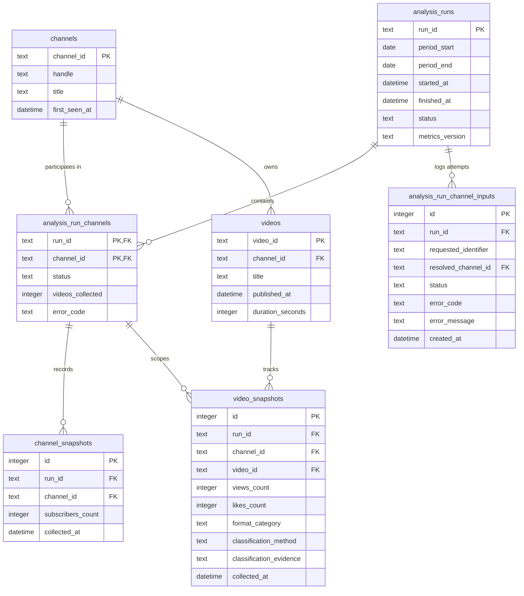

# 🗄️ Relational Database Schema & Data Retention

EchoScope AI uses a normalized SQLite relational schema configured with **Write-Ahead Logging (WAL)**, composite primary keys, and strict foreign key integrity (`PRAGMA foreign_keys = ON;`).

---

## 1. Entity-Relationship Diagram

---

## 2. Table Definitions & Constraints

### `channels` (Dimension)
- `channel_id` (`TEXT PRIMARY KEY`): Canonical 24-character YouTube Channel ID (`UCxxxx`).
- `handle` (`TEXT NOT NULL`): Current vanity handle (`@MrBeast`).
- `title` (`TEXT NOT NULL`): Channel display title.
- `first_seen_at` (`DATETIME`): Initial discovery timestamp.

### `analysis_runs` (Dimension)
- `run_id` (`TEXT PRIMARY KEY`): Unique run identifier (e.g. `run_20261110_015411_a1b2c3`).
- `period_start` (`DATE NOT NULL`): Window lower bound.
- `period_end` (`DATE NOT NULL`): Window upper bound.
- `status` (`TEXT CHECK(status IN ('pending', 'running', 'completed', 'failed', 'partial'))`).
- `metrics_version` (`TEXT DEFAULT '1.0'`).

### `analysis_run_channels` (Associative Bridge)
- `PRIMARY KEY (run_id, channel_id)`: Bridges execution runs with resolved channels, allowing independent tracking of each channel's outcome within a batch (`'pending'`, `'completed'`, `'failed'`, `'empty'`).
- `error_code` (`TEXT`): Records specific typed API error (`QuotaExceededError`, `NetworkError`).

### `analysis_run_channel_inputs` (Input Audit Log)
- `UNIQUE (run_id, requested_identifier)`: Logs every user-supplied channel identifier attempt (`resolved_channel_id` nullable). Prevents unresolved or invalid identifiers from polluting the canonical `channels` dimension with synthetic rows.

### `channel_snapshots` (Fact)
- `UNIQUE (run_id, channel_id)`: Point-in-time subscriber snapshot (`collected_at` timestamp used as the authoritative baseline for VPD and Growth Signals).
- `subscribers_count` (`INTEGER NULL`): Preserves `NULL` when creators conceal public subscriber counts.

### `videos` (Dimension)
- `video_id` (`TEXT PRIMARY KEY`): YouTube 11-character video ID.
- `channel_id` (`TEXT NOT NULL, FOREIGN KEY REFERENCES channels(channel_id)`).
- `published_at` (`DATETIME NOT NULL`): Extracted strictly from `contentDetails.videoPublishedAt`.
- `duration_seconds` (`INTEGER NOT NULL`).

### `video_snapshots` (Fact)
- `UNIQUE (run_id, video_id)`: Enforces exactly one snapshot per video within a given execution.
- Composite Foreign Keys:
  - `FOREIGN KEY (run_id, channel_id) REFERENCES analysis_run_channels(run_id, channel_id) ON DELETE CASCADE`
  - `FOREIGN KEY (video_id, channel_id) REFERENCES videos(video_id, channel_id) ON DELETE CASCADE`
- `format_category` (`CHECK(format_category IN ('Shorts', 'Long-form', 'Unknown'))`).

---

## 3. Data Retention & WAL Backups

- **Online WAL Backups:** Implemented via SQLite native Backup API (`source_conn.backup(dest_conn)`), ensuring safe, consistent file snapshots without locking or corrupting active Write-Ahead Logging (`-wal`) journal files.
- **Data Purging Policy:** `purge_expired_records(conn, retention_days=30)` removes stale execution runs and cleans orphaned video/channel dimensions that no longer link to active snapshots.
