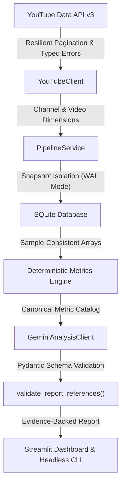

# 🔴 EchoScope AI — YouTube Competitive Intelligence & Strategic Analytics

[](https://www.python.org/)
[](LICENSE)
[](https://github.com/astral-sh/ruff)
[](https://github.com/microsoft/pyright)
[](docs/testing-strategy.md)
[](tests/)

**EchoScope AI** is a production-grade competitive intelligence platform designed to track, benchmark, and analyze YouTube channels and content formats. Built as a software and data engineering portfolio project, it solves critical reliability issues present in typical creator tools: snapshot contamination, vanity metric distortion, unhandled API quota limits, and AI hallucinations.

---

## 🏛️ Core Architectural Principle: *"Python Calculates; Gemini Interprets"*

In analytical systems, allowing an LLM to perform statistical calculations or invent performance metrics leads to hallucinations (e.g. fabricated CTRs, false retention curves). 

EchoScope AI enforces a strict architectural boundary:
1. **Deterministic Python Engines** calculate all mathematical indicators (medians, percentiles, VSR, weighted likes-to-views, daily velocities).
2. **Google Gemini (`gemini-3.8-flash`)** receives pre-calculated numbers mapped to canonical identifiers (`metric_id`) and provides qualitative strategic hypotheses.
3. **Pydantic Schemas (`EchoScopeReport`)** validate all model outputs; any citation of non-existent metrics automatically triggers a verified deterministic fallback report.



---

## 🚀 Key Engineering Highlights

- **Temporal Snapshot Isolation:** Relational schema (`analysis_runs`, `analysis_run_channels`, `channel_snapshots`, `video_snapshots`) indexed by unique `run_id`. Repeating a collection never contaminates historical aggregates.
- **Resilient Batch Operations:** Partial failure tolerance ensures that if 1 of 5 channels fails (e.g. 404 Not Found, channel suspended, or network timeout), valid channels are persisted and analyzed with status `partial`.
- **Interrupted Run Reconciliation:** Abrupt process crashes leave no zombie `running` executions; a startup reconciliation pass inspects persisted data and cleanly marks runs as `partial` or `failed`.
- **Growth Signals & Negative Adjustment Isolation:** Distinguishes genuine new uploads from omitted historical videos, and isolates gross positive view growth from negative view count adjustments ($$\Delta V < 0$$).
- **Format Classifier (YouTube Rules Aligned):** Correctly handles YouTube's 15/10/2024 and 08/12/2025 rule cutoffs (allowing up to 180s for Shorts), admitting explicit `Unknown` when third-party video orientation cannot be confirmed.
- **AST-Based Architectural Boundary Testing:** Enforces decoupled UI layers by inspecting Python Abstract Syntax Trees (`ast.parse`), prohibiting direct database or external API imports inside `ui/`.

---

## 📐 Mathematical Metrics Engine

| Metric | Formula / Definition | Rationale & Handling |
| :--- | :--- | :--- |
| **Median Views ($$\tilde{x}$$)** | Middle value of sorted views with sample size ($$n$$) | Eliminates viral outlier skewness inherent in power-law view distributions. |
| **VSR** | $$\frac{\sum \text{Views}}{\text{Subscribers}}$$ | Normalizes sampled video views relative to subscriber count. Preserves `NULL` when subscribers are hidden. |
| **Likes-to-Views Ratio** | $$\left(\frac{\sum \text{Likes}_k}{\sum \text{Views}_k}\right) \times 100$$ | Denominator strictly excludes videos with concealed like counts to avoid artificially depressed percentages. |
| **Views per Day (VPD)** | $$\frac{\text{Views}}{\text{Collected At} - \text{Published At}}$$ | Measured against run snapshot date rather than local clock, ensuring reproducible historical values. |
| **Growth Velocity ($$R$$)** | $$R = \frac{\Delta V}{\Delta t}$$ (views per day) | Tracks identical videos across two snapshot dates ($$T_0 \to T_1$$), isolating gross positive growth from negative view count adjustments. |
| **Tracked Views Share** | $$\left(\frac{\text{Channel Views}}{\sum \text{Tracked Views}}\right) \times 100$$ | Semantically honest label representing the monitored competitive sample, not the entire YouTube platform. |

*For complete mathematical proofs and edge-case handling, refer to [Metrics Methodology](docs/metrics-methodology.md).*

---

## 💻 Headless Command-Line Interface (CLI)

The core application operates completely independently of the web UI. Headless execution is available via the `echoscope` command:

```bash
# 1. Execute an isolated collection run across target channels
echoscope collect --channels @MrBeast @veritasium @mkbhd --start 2026-01-01 --end 2026-01-31

# 2. List historical runs (works 100% offline without API keys)
echoscope list-runs

# 3. Inspect macro overview and tracked sample shares
echoscope overview --run-id run_20261110_015411_a1b2c3

# 4. Compare growth signals and velocity between two snapshot dates
echoscope compare --channel-id UC_ALPHA --older run_t0 --newer run_t1

# 5. Generate structured strategic AI diagnosis
echoscope report --channel-id UC_ALPHA --run-id run_20261110_015411_a1b2c3
```

### CLI Exit Codes
- `0` (`EXIT_SUCCESS`): Complete batch success.
- `1` (`EXIT_ERROR`): Critical runtime error or invalid execution ID.
- `2` (`EXIT_INVALID_ARGUMENTS`): Syntax error or invalid date format.
- `3` (`EXIT_PARTIAL`): Partial success (some channels succeeded, others failed).

---

## 🖥️ Streamlit Interactive Dashboard

The dashboard provides a decoupled visual interface consuming exclusively `PipelineService`:

1. **📊 Market Overview:** Macro sample metrics, views bar charts, donut shares, channels table, and stacked format distributions.
2. **🎬 Video Explorer:** Granular scatter plots over publication timeline, format filtering (Shorts, Long-form, Unknown), and individual video statistics.
3. **📈 Growth Signals:** Interactive inter-snapshot comparison, measuring daily pace $$R$$, gross growth, negative view count adjustments, and new uploads.
4. **🤖 Strategic AI Report:** Evidence-backed strategic diagnosis rendered in 4 mandatory blocks: *Observed Data*, *Performance Patterns*, *Strategic Hypotheses*, and *Study Limitations*.

---

## ⚙️ Installation & Setup

### Prerequisites
- Python 3.12 or higher installed.
- YouTube Data API v3 Key (Google Cloud Console).
- Google Gemini API Key (Google AI Studio).

### 1. Clone the Repository
```bash
git clone https://github.com/ledrodh/EchoScope-AI.git
cd EchoScope-AI
```

### 2. Configure Environment Variables
Create `.env` from `.env.example`:
```bash
cp .env.example .env
```
Fill in your credentials:
```ini
YOUTUBE_API_KEY=AIzaSyYourActualYouTubeKeyHere
GEMINI_API_KEY=AIzaSyYourActualGeminiKeyHere
GEMINI_MODEL=gemini-3.8-flash
DATABASE_PATH=youtube_tracker.db
```

### 3. Install Dependencies
```bash
python -m venv .venv
source .venv/bin/activate  # On Windows: .venv\Scripts\activate
pip install -e ".[dev]"
```

### 4. Launch the Application
- **Windows Shortcut:** Double-click [`START_TRACKER.bat`](START_TRACKER.bat)
- **Direct Terminal:**
```bash
streamlit run app.py
```

---

## 🧪 Testing & Local Quality Assurance

EchoScope AI enforces automated quality gates through a local QA verification framework (`quality.ps1`):

```bash
# Run full offline test suite (Unit & Integration)
pytest -v

# Run local QA Engine in Fast Mode (Pre-delivery checks)
powershell -ExecutionPolicy Bypass -File "$env:USERPROFILE\dev-tools\qa\quality.ps1" -Mode Fast

# Run full QA Engine with statement & branch coverage, Bandit SAST, and pip-audit
powershell -ExecutionPolicy Bypass -File "$env:USERPROFILE\dev-tools\qa\quality.ps1" -Mode Full
```

### Local QA Gate Results
- **Statements Coverage:** **95.03%**
- **Branch Coverage:** **79.22%**
- **Pyright Static Typing:** **0 Errors, 0 Warnings**
- **Bandit SAST Security:** **0 Vulnerabilities (3,463 lines audited)**
- **pip-audit Dependency Audit:** **0 Known Vulnerabilities**
- **Test Suite:** **70/70 Tests Passing (100% Offline with Mocks)**

---

## 📚 Technical Documentation

Deep-dive architectural documentation is available in the [`docs/`](docs/) directory:
- [Architecture & Layers](docs/architecture.md)
- [Mathematical Methodology](docs/metrics-methodology.md)
- [Database Schema & Migrations](docs/database-schema.md)
- [Testing Strategy & AST Inspection](docs/testing-strategy.md)

---

## 📄 License

This project is licensed under the MIT License — see the [LICENSE](LICENSE) file for details.
